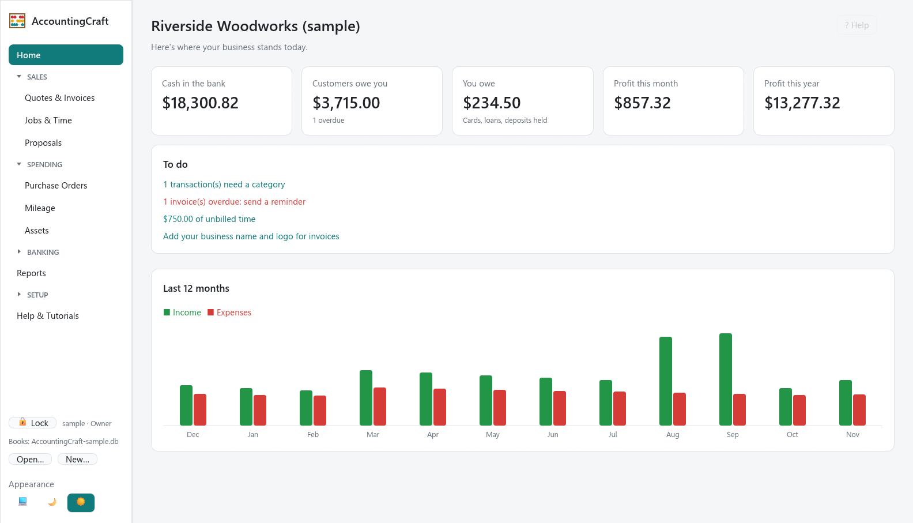
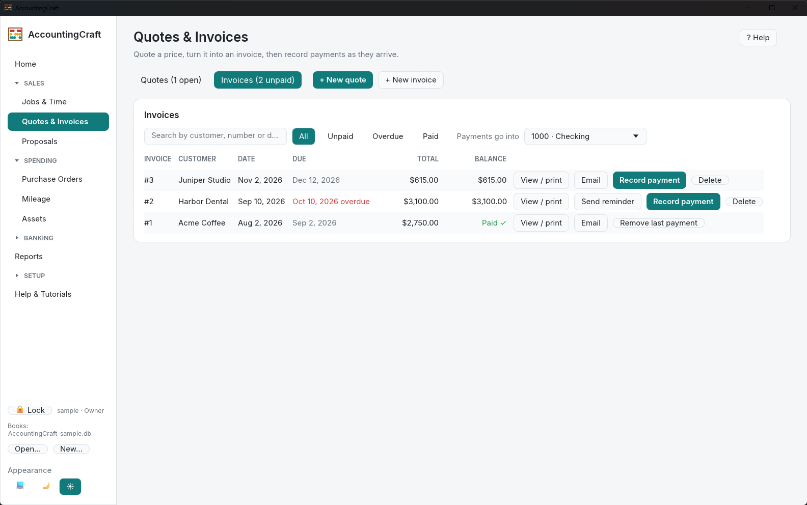
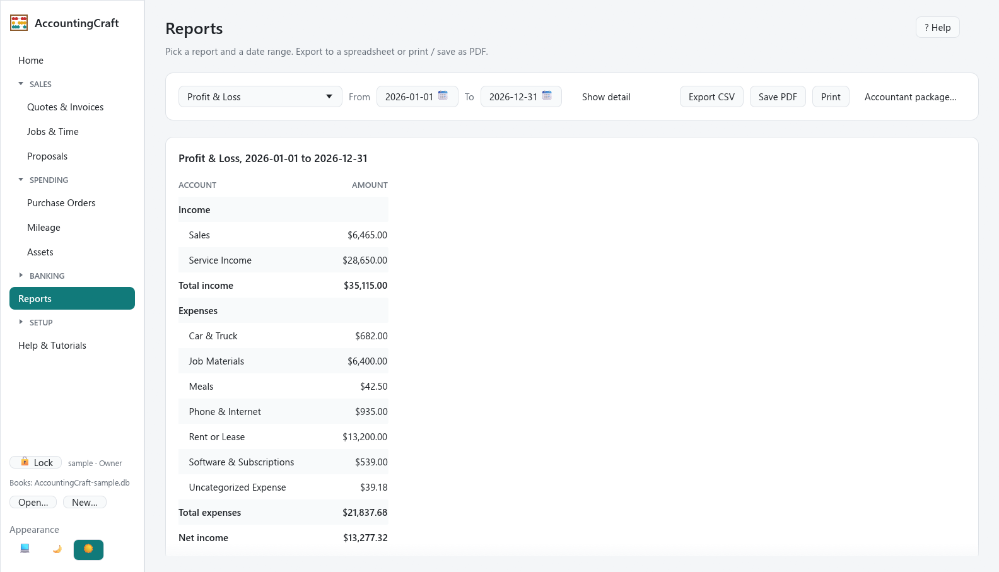

# AccountingCraft

Simple, private bookkeeping for solopreneurs. Invoices, banking, reports and tax-time numbers in one
encrypted file on your own computer. No account, no cloud, no subscription.



## What it does

- **Get paid:** quotes that turn into invoices, deposits, payment reminders, an optional "Pay online"
  link, and PDFs you can email straight from the app.
- **Track the work:** jobs with time tracking and job profitability, proposals, purchase orders,
  mileage and fixed assets with depreciation.
- **Banking:** import bank CSVs or connect a bank feed through [SimpleFIN](https://www.simplefin.org/),
  categorize with rules, and reconcile against statements.
- **Reports:** Profit & Loss, Balance Sheet, Trial Balance, General Ledger, A/R Aging, Sales by
  Customer, Expenses by Vendor, Job Profitability, Sales Tax, Schedule C summary, 1099 vendors,
  estimated quarterly tax and a mileage log. Export to CSV or PDF, or build a one-folder
  **accountant package** (PDFs, CSVs and QuickBooks Online import files) for your CPA.
- **Easy to learn:** money in and money out on the surface, real double-entry underneath. Help for
  every screen (F1) and short guided tutorials.

Want to look around first? On the first screen, choose **Try with sample books**. That opens a
made-up business with a year of activity, and your own books aren't touched.

| Quotes & invoices | Reports |
|---|---|
|  |  |

## Your data stays yours

- Each business is one file (`my-books.db` in `Documents\AccountingCraft` by default). Back it up by
  copying it; the app also keeps automatic backups in a `backups` folder beside it.
- **The file is encrypted** with SQLCipher (AES-256). The key is random, and each login holds its own
  copy wrapped with a key made from that person's password (Argon2id). The key file (`.keys`) sits
  beside the books and is needed to open them, so back up both.
- **Logins:** an owner, plus optional bookkeeper and view-only logins. The app locks itself after
  15 minutes without use.
- **Recovery key:** shown once when you protect your books. If every owner forgets their password, it
  is the only way back in. Nobody, including the authors, can recover your books without it.
- **Removing someone:** their login stops working at once. If they might have kept a copy of the
  key file, **Change the encryption key** re-encrypts the books so that copy no longer opens them
  (backups made before then keep the old key).
- The app only goes online when you ask it to: bank feeds through SimpleFIN, and links you click.

## Download

Get the latest build from [Releases](https://github.com/DrDMo/accountingcraft/releases), or install it
from the ArtCraft Launcher. Windows is the main platform; Linux builds are also published.

## Build it yourself

You need [Rust](https://rustup.rs) (stable). SQLCipher is compiled from source with a bundled
OpenSSL, which needs Perl:

- **Windows:** install [Strawberry Perl](https://strawberryperl.com) and put it first on `PATH`
  (Git for Windows' Perl is missing modules OpenSSL needs). The Windows SDK (comes with Visual
  Studio Build Tools) embeds the icon.
- **Linux:** `perl`, `make` and a C compiler, plus the usual egui libraries
  (`libxkbcommon-dev libxcb-render0-dev libxcb-shape0-dev libxcb-xfixes0-dev`).
- **macOS:** the Xcode command line tools.

```sh
cargo build --release
cargo test
```

PDFs use Inter from [craft-fonts](https://github.com/storytold/craft-fonts) when it's available, and
egui's built-in font otherwise. Release builds require it:

```sh
git clone --depth 1 https://github.com/storytold/craft-fonts ../craft-fonts
CRAFT_FONTS_DIR=$PWD/../craft-fonts CRAFT_FONTS_REQUIRED=1 cargo build --release
```

`cargo deny check licenses` checks every dependency against the Craft licence allowlist.

## License

AccountingCraft is free and open source under either the [MIT](LICENSE-MIT) or
[Apache 2.0](LICENSE-APACHE) license, at your choice. Third-party assets are listed in
[ATTRIBUTION.md](ATTRIBUTION.md).

AccountingCraft is a community app for the [ArtCraft](https://getartcraft.com) Craft App Suite and
isn't made by the ArtCraft team. It isn't tax or legal advice; check the numbers with your accountant.
